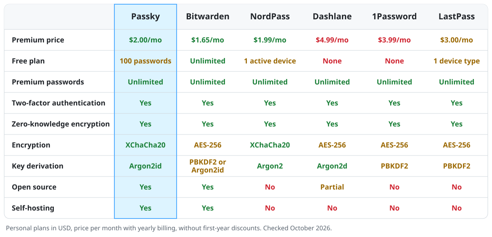

<h1 align="center">🔒 Passky Server 🔒</h1>

[](https://github.com/Rabbit-Company/Passky-Server/issues)
[](https://github.com/Rabbit-Company/Passky-Server/stargazers)
[](https://github.com/Rabbit-Company/Passky-Server/network)
[](https://github.com/Rabbit-Company/Passky-Server/blob/main/LICENSE)

### [Download from Official Website](https://passky.org/download)

## Passky Clients

- [Website](https://github.com/Rabbit-Company/Passky-Website#installation)
- [Browser Extension](https://github.com/Rabbit-Company/Passky-Browser-Extension#installation)
- [Desktop Application](https://github.com/Rabbit-Company/Passky-Desktop#installation)
- [Android Application](https://github.com/Rabbit-Company/Passky-Android#installation)

## What is Passky?

Passky is a simple, modern, lightweight, open source and secure password manager.

[](https://www.youtube.com/watch?v=yrk6cHkgVA8 "Click to watch!")

## How Much Does it Cost?

Passky is a **free**, open-source password manager that simplifies your digital life. Both the free and premium plans include advanced security features such as two-factor authentication to ensure the safety and security of your sensitive data.

While the free plan allows you to store up to 100 passwords, the premium plan offers additional benefits such as the ability to store an unlimited number of passwords. [Upgrade to the premium plan](https://passky.org/pricing) to gain access to all of Passky's features and take your password security to the next level.

At Passky, we take your security seriously, and we don't compromise on safety when it comes to password management. [Sign up now](https://vault.passky.org/register) and experience the peace of mind that comes with using Passky.

## How it Works?

Passky uses a combination of advanced encryption methods to ensure the security of your data.

Passky is based on a **zero trust architecture** and uses advanced encryption methods such as **XChaCha20** and **Argon2id** to ensure the security of your sensitive data.

For sensitive data encryption, Passky uses **XChaCha20**, a state-of-the-art encryption algorithm that provides a **high level of security and performance**. This encryption method is designed to be **resistant to known-plaintext attacks and other forms of cryptanalysis**.

For master password hashing, Passky uses **Argon2id**, a password-hashing algorithm that has been recognized as the winner of multiple password-hashing competitions, such as the **[Password Hashing Competition (PHC)](https://www.password-hashing.net)** held by the community. It is designed to be **resistant to brute-force attacks**. This algorithm uses a combination of memory-hard and data-dependent techniques to make it difficult for attackers to guess your master password.

When you save your account information to Passky, **all sensitive data is fully encrypted** using **XChaCha20**. The encrypted data is then stored on Passky's servers.

When you try to access your account, Passky will prompt you to input your master password. The master password is then hashed using **Argon2id** algorithm to ensure its security. The hashed master password is then used to decrypt the sensitive data, allowing you to access your account.

In summary, **Passky uses advanced encryption methods such as XChaCha20 and Argon2id** to ensure the security of your sensitive data and master password, making it difficult for anyone to access your information without your permission.

## How Does Passky Compare to the Competition?

<picture>
  <source media="(prefers-color-scheme: dark)" srcset="docs/images/comparison-dark.svg">
  
</picture>

<details>
<summary>Comparison as a table</summary>

| Feature                   |    Passky     |     Bitwarden      |    NordPass     | Dashlane  | 1Password |   LastPass    |
| ------------------------- | :-----------: | :----------------: | :-------------: | :-------: | :-------: | :-----------: |
| Premium price             |   $2.00/mo    |      $1.65/mo      |    $1.99/mo     | $4.99/mo  | $3.99/mo  |   $3.00/mo    |
| Free plan                 | 100 passwords |     Unlimited      | 1 active device |   None    |   None    | 1 device type |
| Premium passwords         |   Unlimited   |     Unlimited      |    Unlimited    | Unlimited | Unlimited |   Unlimited   |
| Two-factor authentication |      Yes      |        Yes         |       Yes       |    Yes    |    Yes    |      Yes      |
| Zero-knowledge encryption |      Yes      |        Yes         |       Yes       |    Yes    |    Yes    |      Yes      |
| Encryption                |   XChaCha20   |      AES-256       |    XChaCha20    |  AES-256  |  AES-256  |    AES-256    |
| Key derivation            |   Argon2id    | PBKDF2 or Argon2id |     Argon2      |  Argon2d  |  PBKDF2   |    PBKDF2     |
| Open source               |      Yes      |        Yes         |       No        |  Partial  |    No     |      No       |
| Self-hosting              |      Yes      |        Yes         |       No        |    No     |    No     |      No       |

Personal plans in USD, price per month with yearly billing, without first-year discounts. Checked October 2026.

</details>

## Installation

Passky Server runs on [Bun](https://bun.com/) and stores data in SQLite, MySQL, MariaDB, or PostgreSQL. It can be installed in multiple ways.

- [Docker](https://github.com/Rabbit-Company/Passky-Server/blob/main/docs/installation/docker.md) (Recommended)
- [Umbrel](https://apps.umbrel.com/app/passky-server) (One-click Install)

All settings are described in the [configuration reference](https://github.com/Rabbit-Company/Passky-Server/blob/main/docs/configuration.md).

## Upgrade

To upgrade your Passky Server, please **select the installation method** that you previously used to set up your server. This will ensure a seamless upgrade process and minimal disruption to your current Passky Server configuration. If you have any issues or concerns during the upgrade process, please do not hesitate to reach out to our support team for assistance.

- [Docker](https://github.com/Rabbit-Company/Passky-Server/blob/main/docs/upgrade/docker.md)
- [Upgrading from Passky Server 8 (PHP)](https://github.com/Rabbit-Company/Passky-Server/blob/main/docs/upgrade/php-to-bun.md)

## Development

```sh
bun install
bun run test
bun run typecheck
bun run dev
```

`bun run dev` starts the server with file watching. Settings are read from `.env`. The tests never load it and always run against an in-memory SQLite database.

Pull requests to `main` run the type check and test suite. Pushes to `main` publish `rabbitcompany/passky-server:latest`, and GitHub releases publish the versioned image tags.

## License

Passky Server is licensed under the [European Union Public Licence v. 1.2](https://github.com/Rabbit-Company/Passky-Server/blob/main/LICENSE) (EUPL-1.2). Releases up to and including 8.1.8 were published under the GNU General Public License v3.0 and remain available under those terms.
